# ambientCG: Asphalt materials

**23 assets from [ambientCG](https://ambientcg.com), dedicated to the public domain under [CC0](https://docs.ambientcg.com/license/).** Use them in any game, free or paid, and change them however you like; no credit is needed.

PBR materials as 1K and 2K JPG maps (colour, normal GL and DX, roughness, AO, displacement), one folder per resolution. 888.2 MB in all.

This is a copy kept by [zuujis-cc0](https://github.com/zuujis-cc0) so game makers can take single files from GitHub. It is not made by or affiliated with ambientCG: the originals, often in more formats and higher resolutions, are on [ambientcg.com](https://ambientcg.com). If they help you, consider [supporting ambientCG](https://www.patreon.com/ambientCG).

Every file is listed in [MANIFEST.tsv](MANIFEST.tsv) with its size and SHA-256. More free assets: [the Zuujis collection](https://github.com/zuujis-cc0/free-game-assets#readme).

| | | | |
| :-: | :-: | :-: | :-: |
| <a href="Asphalt001">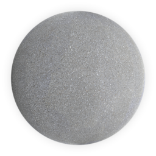</a> <b><a href="Asphalt001">Asphalt 001</a></b> by ambientCG · <a href="https://ambientcg.com/a/Asphalt001">source</a> | <a href="Asphalt002">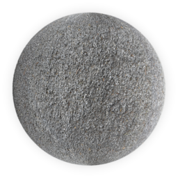</a> <b><a href="Asphalt002">Asphalt 002</a></b> by ambientCG · <a href="https://ambientcg.com/a/Asphalt002">source</a> | <a href="Asphalt003">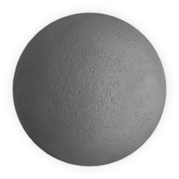</a> <b><a href="Asphalt003">Asphalt 003</a></b> by ambientCG · <a href="https://ambientcg.com/a/Asphalt003">source</a> | <a href="Asphalt004">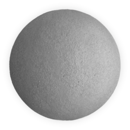</a> <b><a href="Asphalt004">Asphalt 004</a></b> by ambientCG · <a href="https://ambientcg.com/a/Asphalt004">source</a> |
| <a href="Asphalt005">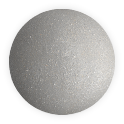</a> <b><a href="Asphalt005">Asphalt 005</a></b> by ambientCG · <a href="https://ambientcg.com/a/Asphalt005">source</a> | <a href="Asphalt006">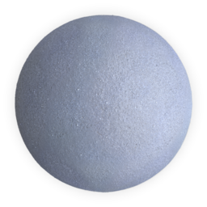</a> <b><a href="Asphalt006">Asphalt 006</a></b> by ambientCG · <a href="https://ambientcg.com/a/Asphalt006">source</a> | <a href="Asphalt007">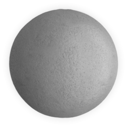</a> <b><a href="Asphalt007">Asphalt 007</a></b> by ambientCG · <a href="https://ambientcg.com/a/Asphalt007">source</a> | <a href="Asphalt008">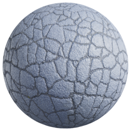</a> <b><a href="Asphalt008">Asphalt 008</a></b> by ambientCG · <a href="https://ambientcg.com/a/Asphalt008">source</a> |
| <a href="Asphalt009">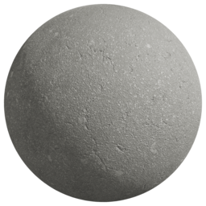</a> <b><a href="Asphalt009">Asphalt 009</a></b> by ambientCG · <a href="https://ambientcg.com/a/Asphalt009">source</a> | <a href="Asphalt010">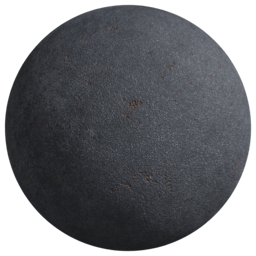</a> <b><a href="Asphalt010">Asphalt 010</a></b> by ambientCG · <a href="https://ambientcg.com/a/Asphalt010">source</a> | <a href="Asphalt011">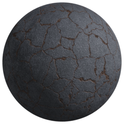</a> <b><a href="Asphalt011">Asphalt 011</a></b> by ambientCG · <a href="https://ambientcg.com/a/Asphalt011">source</a> | <a href="Asphalt012">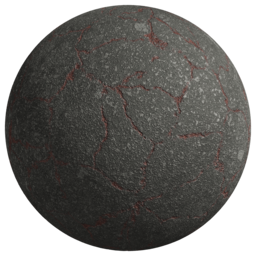</a> <b><a href="Asphalt012">Asphalt 012</a></b> by ambientCG · <a href="https://ambientcg.com/a/Asphalt012">source</a> |
| <a href="Asphalt013">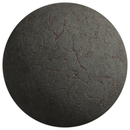</a> <b><a href="Asphalt013">Asphalt 013</a></b> by ambientCG · <a href="https://ambientcg.com/a/Asphalt013">source</a> | <a href="Asphalt014">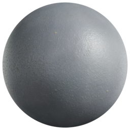</a> <b><a href="Asphalt014">Asphalt 014</a></b> by ambientCG · <a href="https://ambientcg.com/a/Asphalt014">source</a> | <a href="Asphalt015">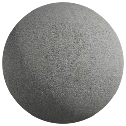</a> <b><a href="Asphalt015">Asphalt 015</a></b> by ambientCG · <a href="https://ambientcg.com/a/Asphalt015">source</a> | <a href="Asphalt016">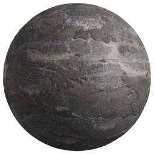</a> <b><a href="Asphalt016">Asphalt 016</a></b> by ambientCG · <a href="https://ambientcg.com/a/Asphalt016">source</a> |
| <a href="Asphalt017">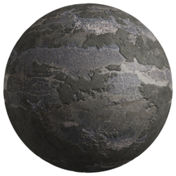</a> <b><a href="Asphalt017">Asphalt 017</a></b> by ambientCG · <a href="https://ambientcg.com/a/Asphalt017">source</a> | <a href="Asphalt018">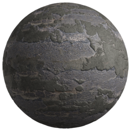</a> <b><a href="Asphalt018">Asphalt 018</a></b> by ambientCG · <a href="https://ambientcg.com/a/Asphalt018">source</a> | <a href="Asphalt019">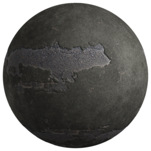</a> <b><a href="Asphalt019">Asphalt 019</a></b> by ambientCG · <a href="https://ambientcg.com/a/Asphalt019">source</a> | <a href="Asphalt020L">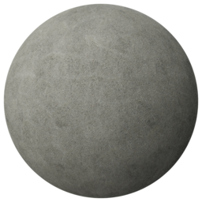</a> <b><a href="Asphalt020L">Asphalt 020 L</a></b> by ambientCG · <a href="https://ambientcg.com/a/Asphalt020L">source</a> |
| <a href="Asphalt020S">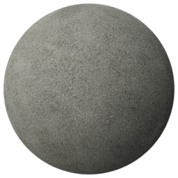</a> <b><a href="Asphalt020S">Asphalt 020 S</a></b> by ambientCG · <a href="https://ambientcg.com/a/Asphalt020S">source</a> | <a href="Asphalt021">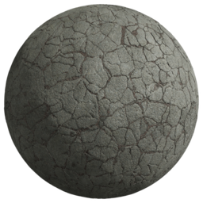</a> <b><a href="Asphalt021">Asphalt 021</a></b> by ambientCG · <a href="https://ambientcg.com/a/Asphalt021">source</a> | <a href="Asphalt022">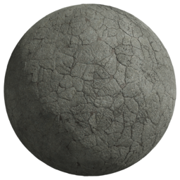</a> <b><a href="Asphalt022">Asphalt 022</a></b> by ambientCG · <a href="https://ambientcg.com/a/Asphalt022">source</a> |  |

---

Kept up to date by this repository's own [update workflow](.github/workflows/update.yml), with code and plan from [cc0-mirror](https://github.com/zuujis-cc0/cc0-mirror). Something wrong? [Open an issue there](https://github.com/zuujis-cc0/cc0-mirror/issues/new) or use the [private report form](https://games.zuujis.com/report).
